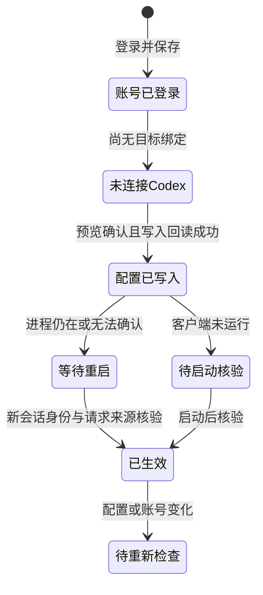

# #377 增量 PRD：Codex 官方账号连接可核验、认证页结果收拢与 omp 最小适配

状态：待评审方案；日期：2026-10-20。代码基线：`fy-agent/fyagent main afa999610e85343823ce1d8b46f46dcd38dc8249`。本次仅查阅代码、工单与上游公开资料，未改源码、未运行用户客户端、未读用户凭据、未进行外部写操作。

证据等级为 **code_audit**。#377 的截图只有文字转录，没有原图；本文没有 `runtime_screenshot` 或 `pixel_diff`，不宣称 Windows 问题已复现、修复或通过验收。下面“现状”是已读代码，“拟改”是方案；本机根因的未证实部分明确标为“推断”。不承诺版本、排期、转化率或模型权限。

## 1. 立项判断与重复覆盖核对

**结论：有新方案，值得写一份增量 PRD，但不能把三件事都当成全新底座重做。** GitHub 只读 API 本轮核实 [#377](https://github.com/fy-agent/fyagent/issues/377) 仍为 open，创建于 2026-10-19，作者 zgyj4532，无评论、无指派。已有票覆盖部分原则与基础设施，尚没有解决其全部可观察症状的可用端到端方案。

| #377 子问题 | 已有覆盖及具体位置 | 本轮净增范围 |
| --- | --- | --- |
| 官方登录后 Codex 仍显示 API/custom；模型按钮灰色 | [#374](https://github.com/fy-agent/fyagent/discussions/374) FR-12 有模型失败分类、FR-14 有预览/应用/回读、FR-17 有人话化，但主路径是 API Key。 [#205](https://github.com/fy-agent/fyagent/issues/205) 已列 Codex 凭据保留、ChatGPT 身份/工作区与重登录绑定；[#206](https://github.com/fy-agent/fyagent/issues/206) 已列切官方账号后的认证恢复及配置事务；[#209](https://github.com/fy-agent/fyagent/issues/209) 已列原生模型聚合和重载；[#211](https://github.com/fy-agent/fyagent/issues/211) 已列账号/模式状态及中文失败呈现。 | 补具体复现分支、凭据用途与请求来源的状态合同、官方镜像 custom 的辨认、强制认证冲突、模型入口禁用原因，以及重启后核验标准。复用已有 writer/Change Plan，不另建账号或聚合系统。 |
| 认证页顶部结果卡片挤压主操作区 | #211 的默认层级、按需展开、批量结果、窄窗口验收已有方向；#374 FR-17/18 是更广的术语与首页需求。均没有针对 `ConnectionResults` 的紧凑交互及尺寸验收。 | 对现有组件做一次局部收拢；失败、重启与部分完成仍有持久入口。不重排整个应用导航。 |
| omp 可配置软件 | #374 第 4 节明确“不新增目标软件”；[#208](https://github.com/fy-agent/fyagent/issues/208) 点名 MiniMax Code、Pi、OpenCode、Hermes，没有定义 Oh My Pi 的文件/认证契约。**Pi 与 omp 不可互相冒充覆盖**。 | 单独的 omp Provider/模型文件适配，不把 #208 的 Pi 默认模型/MCP 限制原样搬来。视为 #374 范围之外的独立增量，不改写其已讨论范围。 |

[PR #376](https://github.com/fy-agent/fyagent/pull/376) 本轮仍 open，实际 head 为 `d91ff95bbd3e89b931531092d602dab58b6b81e4`（正文仍引用较早尖端，不能用正文 SHA 当最新证据）。正文和文件清单指向 WorkBuddy 订阅 Change Plan、原子写、回滚、来源读回；明确不含第三刀 UI/第四刀集成。它改了公共 `change_plan`、DTO、ports 和 ACL，存在文件冲突，但**不实现 Codex 原生认证切换、认证页结果收拢或 omp**。公共 DTO 的演进应协调，不能重复新增另一套事务系统。

其余开放项逐项归类：#363/#364 是提示词保存/跨目标状态；PR #369 是 OpenCode/VibeKey 已保存供应商模型刷新，不能当成 ChatGPT 订阅列表修复；#67/#68 是 Windows 签名；#204 是迁移总纲；#207 是资源分配；#210 是会话/用量；#212 是可选原生工具入口；#213 是跨设备验收框架。PR #198、草稿 #180/#214/#356 分别属于会话/安装、盘点、迁移文档、Windows helper 测试。它们均没有本轮三项的完整方案，不重新立项这些旧主题。[#43](https://github.com/fy-agent/fyagent/issues/43) 官方登录历史票已 closed/completed，只作为历史背景。

## 2. 问题与证据

### 2.1 用户实际报告，不加根因解释

依据 [issue377.md](https://github.com/fy-agent/fyagent/issues/377)：Windows 11 22621，FyAgent 0.4.14，Codex 桌面包 26.1007.2314.0，CLI 0.156.1。桌面包与 CLI 是两种版本，不能互相代替测试。

- 账号页显示“账号已保存”“默认账号”“正常”，但同屏是“软件连接 0/5”“尚未连接软件”“登录不会自动连接软件”。因此未证明已连接 Codex。
- Codex 菜单显示 custom；模型页有“已切换为直连，请重新打开 Codex”提示。没有重启后的证据，也没有实际请求落点证据。
- “使用账号订阅（实验性）”里选了 ChatGPT，“查看模型选项”灰色，出现手填订阅模型 ID。灰色不等于网络请求失败。
- 被遮挡布局中的结果属于 **OpenCode Desktop · OpenAI**，不能拿来证明 Codex 连接成功。

### 2.2 已查到的代码链路

以下路径均相对仓库根目录，链接固定到 main `afa99961`。行号是定位辅助，实施前应重新核对目标基线。

| 编号 | 路径 / 关键函数 | 已确认事实与设计意义 |
| --- | --- | --- |
| C01 | [src/pages/auth/LoginDialog.tsx](https://github.com/fy-agent/fyagent/blob/afa999610e85343823ce1d8b46f46dcd38dc8249/src/pages/auth/LoginDialog.tsx#L146) `startLogin`；[useManagedAuthLoginSession.ts](https://github.com/fy-agent/fyagent/blob/afa999610e85343823ce1d8b46f46dcd38dc8249/src/pages/auth/useManagedAuthLoginSession.ts#L13)；[managedAuth.ts](https://github.com/fy-agent/fyagent/blob/afa999610e85343823ce1d8b46f46dcd38dc8249/src/shared/platform/tauri/feature-ports/managedAuth.ts#L35) | UI 传 provider、purpose、consumer、method、accountId；hook 轮询 session，不直接处理 token。登录用途不是目标软件已经连接的证明。 |
| C02 | [src-tauri/src/services/managed_auth/login.rs](https://github.com/fy-agent/fyagent/blob/afa999610e85343823ce1d8b46f46dcd38dc8249/src-tauri/src/services/managed_auth/login.rs#L69) `start_login`、`run_browser_login`、`run_device_login`、`save_grant`、`purpose_for_login` | 浏览器/设备码两种流程最终保存凭据。`save_grant` 明确不投影软件文件，完成 session 的 connection_id 是 None。`connect_consumer + codex` 保存 `CodexNative`；普通保存默认为 `ProxyUpstream`。同一身份可有不同用途的会话，不可把默认账号或账号 health 当成所有 consumer 的授权。 |
| C03 | [providers/openai.rs](https://github.com/fy-agent/fyagent/blob/afa999610e85343823ce1d8b46f46dcd38dc8249/src-tauri/src/services/managed_auth/providers/openai.rs#L45) `generate_pkce`、`build_authorize_url`、`bind_registered_loopback`、`request_device_usercode`、`poll_device_authorization`、`exchange_authorization_code` | 使用 auth.openai.com，PKCE/state；浏览器回调优先 1455、备用 1457；另有 Codex device flow。不是把网页 cookie 当 API Key。 |
| C04 | [login.rs](https://github.com/fy-agent/fyagent/blob/afa999610e85343823ce1d8b46f46dcd38dc8249/src-tauri/src/services/managed_auth/login.rs#L575) `save_grant`；[service.rs](https://github.com/fy-agent/fyagent/blob/afa999610e85343823ce1d8b46f46dcd38dc8249/src-tauri/src/services/managed_auth/service.rs) `ManagedAuthService`；[core.rs](https://github.com/fy-agent/fyagent/blob/afa999610e85343823ce1d8b46f46dcd38dc8249/src-tauri/src/services/managed_auth/core.rs)、[secret_bundle.rs](https://github.com/fy-agent/fyagent/blob/afa999610e85343823ce1d8b46f46dcd38dc8249/src-tauri/src/services/managed_auth/secret_bundle.rs)、[repository.rs](https://github.com/fy-agent/fyagent/blob/afa999610e85343823ce1d8b46f46dcd38dc8249/src-tauri/src/services/managed_auth/repository.rs) | 保存身份/凭据元数据与秘密引用，与连接记录分离。`save_grant` 调 `provision_legacy_credential`，并非写 Codex auth.json。代理会话和 Codex 原生会话的刷新所有者也需区分。 |
| C05 | [Page.tsx](https://github.com/fy-agent/fyagent/blob/afa999610e85343823ce1d8b46f46dcd38dc8249/src/pages/auth/Page.tsx#L363) `applyConnectionAction`；[connection_actions.rs](https://github.com/fy-agent/fyagent/blob/afa999610e85343823ce1d8b46f46dcd38dc8249/src-tauri/src/services/managed_auth/connection_actions.rs) 预览/确认；[login.rs](https://github.com/fy-agent/fyagent/blob/afa999610e85343823ce1d8b46f46dcd38dc8249/src-tauri/src/services/managed_auth/login.rs#L270) `apply_codex_official_projection` | 软件连接另走预览、expectedRevision 与确认。先吸收原生轮换的旧账号 token，再投影目标账号，随后记录连接与刷新所有权。登录结束的 `finishLogin` 只是关对话框、刷新概览。 |
| C06 | [consumers/codex/project.rs](https://github.com/fy-agent/fyagent/blob/afa999610e85343823ce1d8b46f46dcd38dc8249/src-tauri/src/services/managed_auth/consumers/codex/project.rs#L50) `project_codex_official_account`、`project_under_guard`；[delta.rs](https://github.com/fy-agent/fyagent/blob/afa999610e85343823ce1d8b46f46dcd38dc8249/src-tauri/src/services/managed_auth/consumers/codex/delta.rs#L41) `plan_codex_managed_auth_delta` | 在 Codex 切换锁内核对 revision；注释顶层 `model_provider`，保留 provider 表；必要时交换 auth.json；认证失败后尝试还原 config。它不是完整有效配置解析器，没检查所有 profile/启动覆盖。 |
| C07 | [auth_document.rs](https://github.com/fy-agent/fyagent/blob/afa999610e85343823ce1d8b46f46dcd38dc8249/src-tauri/src/services/managed_auth/consumers/codex/auth_document.rs#L184) `serialize_bytes`；[swap.rs](https://github.com/fy-agent/fyagent/blob/afa999610e85343823ce1d8b46f46dcd38dc8249/src-tauri/src/services/managed_auth/consumers/codex/swap.rs#L52) `swap_codex_chatgpt_auth` | 写入 `auth_mode: chatgpt`、`OPENAI_API_KEY: null`、id/access/refresh token、account_id、last_refresh；做身份核对与受限文件写入。文件 token 不是前端展示数据。热重载常量为 false，不能靠文件成功声称运行进程已接受新账号。 |
| C08 | [codex_config/storage.rs](https://github.com/fy-agent/fyagent/blob/afa999610e85343823ce1d8b46f46dcd38dc8249/src-tauri/src/codex_config/storage.rs#L13) `get_codex_config_dir`；[credential_store.rs](https://github.com/fy-agent/fyagent/blob/afa999610e85343823ce1d8b46f46dcd38dc8249/src-tauri/src/codex_config/credential_store.rs#L37) `allows_native_file_projection` | 写入路径优先 FyAgent 的 `get_codex_override_dir()`，否则用户目录 `.codex`；该函数没有直接读取 `CODEX_HOME`。账号文件投影只允许 unset/file；keyring/auto/ephemeral/unknown 不能假装写 auth.json 即成功。路径是否与 Windows 客户端相同待实机核实。 |
| C09 | [observation.rs](https://github.com/fy-agent/fyagent/blob/afa999610e85343823ce1d8b46f46dcd38dc8249/src-tauri/src/services/managed_auth/consumers/codex/observation.rs#L81) `observe_managed_auth`、`classify_provider_route`；[codex/mod.rs](https://github.com/fy-agent/fyagent/blob/afa999610e85343823ce1d8b46f46dcd38dc8249/src-tauri/src/services/managed_auth/consumers/codex/mod.rs#L37) `connection_summary` | 当前观察根级 selector 与 auth 文件；存在匹配自定义表就归为 ThirdParty/ThirdPartyApi。账号匹配与 `pending_restart` 决定 connected/pending 状态。**这不能精确识别官方 custom 镜像，也不能证明运行中的实际请求。** |
| C10 | [CodexRequestSource.tsx](https://github.com/fy-agent/fyagent/blob/afa999610e85343823ce1d8b46f46dcd38dc8249/src/pages/auth/CodexRequestSource.tsx#L15) `CodexRequestSource`；[services/provider/codex_direct.rs](https://github.com/fy-agent/fyagent/blob/afa999610e85343823ce1d8b46f46dcd38dc8249/src-tauri/src/services/provider/codex_direct.rs#L381) `plan`、`run_with_edits`、`write_direct` | 账号页的“请求来源”复用 ChangePlanWorkspace。供应商写入有独立 planner/engine；此路径保留原生 auth.json/账号标记，不等于连接账号。 |
| C11 | [live/project/codex.rs](https://github.com/fy-agent/fyagent/blob/afa999610e85343823ce1d8b46f46dcd38dc8249/src-tauri/src/live/project/codex.rs#L132) `CodexProjection::of`、`RouteWrite`、`official_mirror_table`、`CodexConfigPatch` | 第三方 live route 规范为 `custom`，Key 进入 provider-scoped `experimental_bearer_token`；也支持 env_key/自身认证。普通官方直连不设 selector；开启统一会话历史时用 `custom` 官方镜像，`requires_openai_auth=true`，无第三方 base_url。第三方仍可保留官方登录，故认证和请求来源必须分开。 |
| C12 | [codex_config.rs](https://github.com/fy-agent/fyagent/blob/afa999610e85343823ce1d8b46f46dcd38dc8249/src-tauri/src/codex_config.rs#L1907) `inject_codex_unified_session_bucket`、`strip_codex_unified_session_bucket`；C10/C11 的 `OfficialMirror`/`OfficialProxy` | 仓库还保留统一会话历史辅助函数；当前 live planner 也有对应路径。原生凭据经过本地代理的 OfficialProxy 与 FyAgent 托管订阅是两种凭据所有权，不能因为都经代理就合并成一种账号状态。 |
| C13 | [XaiSubscriptionSection.tsx](https://github.com/fy-agent/fyagent/blob/afa999610e85343823ce1d8b46f46dcd38dc8249/src/pages/models/XaiSubscriptionSection.tsx#L121) `fetchModels`、`confirmBind`；[services/provider/managed_proxy.rs](https://github.com/fy-agent/fyagent/blob/afa999610e85343823ce1d8b46f46dcd38dc8249/src-tauri/src/services/provider/managed_proxy.rs#L427) `bind_managed_proxy_for`、`build_provider` | 订阅面板接受 xAI/OpenAI；选 ChatGPT 时直接清空列表并展开手填，不发列表请求；按钮条件包含 `selected?.provider !== "xai"`。绑定 Codex 仅保存供应商草稿，`activated=false`，仍需 Change Plan 应用。草稿里 OpenAI slot 是 `fyagent_chatgpt`，live 投影还会规范为 custom，不能把草稿当最终文件。 |
| C14 | [commands/codex_oauth.rs](https://github.com/fy-agent/fyagent/blob/afa999610e85343823ce1d8b46f46dcd38dc8249/src-tauri/src/commands/codex_oauth.rs#L92) `get_codex_oauth_models`；[services/codex_oauth_models.rs](https://github.com/fy-agent/fyagent/blob/afa999610e85343823ce1d8b46f46dcd38dc8249/src-tauri/src/services/codex_oauth_models.rs#L17) `fetch_models_with_token` | 已有通过 CodexOAuthManager 获取有效 token/account_id，再请求 `https://chatgpt.com/backend-api/codex/models` 的能力；带 client_version/originator/account header。**存在后端能力不代表 C13 已接线，也不证明该接口对任意账号永远可用。** |
| C15 | [services/provider/codex_official_models.rs](https://github.com/fy-agent/fyagent/blob/afa999610e85343823ce1d8b46f46dcd38dc8249/src-tauri/src/services/provider/codex_official_models.rs) `OfficialLogin::of`、`rows_for_switch` | 官方聚合目录已有身份/本机版本核验、缓存及 bundled 兜底。身份含工作区和用户；原生 token 由 Codex 刷新，外部只读，避免轮换失配。bundled 列表不是账号权限证明。不能再造一套无身份缓存。 |
| C16 | [ConnectionResults.tsx](https://github.com/fy-agent/fyagent/blob/afa999610e85343823ce1d8b46f46dcd38dc8249/src/pages/auth/ConnectionResults.tsx#L21) `ConnectionResults`；[Page.tsx](https://github.com/fy-agent/fyagent/blob/afa999610e85343823ce1d8b46f46dcd38dc8249/src/pages/auth/Page.tsx#L518)；[page.css](https://github.com/fy-agent/fyagent/blob/afa999610e85343823ce1d8b46f46dcd38dc8249/src/pages/auth/page.css#L255) | 结果 section 放在账户/连接主体之前，每个结果有 h3、InlineNotice、动作 div；成功时动作 div 仍在，无关闭/折叠入口。card 为 grid、gap 12px、padding 14px，section 又有间距。代码支持“结果持续占位”的判断；实际像素高度仅凭源码无法确定。 |

补充可复查发现：对本基线 `src-tauri/src` 搜索 `forced_login_method|preferred_auth_method` 无匹配；因此不能说现有 writer 已主动清除这些限制。C06 只注释 selector 的做法，也不能保证顶层 `openai_base_url`、profile 或启动参数不再影响实际请求。

### 2.3 根因分层，禁止用猜测替代复现

1. **已证实的产品行为**：保存与连接分开；ChatGPT 订阅按钮按 provider 被禁用；Codex 订阅绑定先存草稿；成功结果没有收拢入口；custom 可由官方统一历史模式产生。
2. **代码层缺口**：连接观察把带 provider 表的 custom 一概归第三方；没有 forced_login_method 诊断；`Restart` 分支在 [login.rs](https://github.com/fy-agent/fyagent/blob/afa999610e85343823ce1d8b46f46dcd38dc8249/src-tauri/src/services/managed_auth/login.rs#L247) 清除 pending_restart/更新记录，本分支没有目标进程的新会话证据。不能把此记录更新直接称“已生效”。
3. **推断，待用户环境证据验证**：未连接、未应用订阅草稿、进程未重启、FyAgent 路径与客户端不同、旧 `forced_login_method=api`、profile/启动覆盖、统一会话历史开关，均可能解释部分现象；目前无法选择其中一种作为 #377 根因。

## 3. 上游调研与技术口径

### 3.1 Codex CLI：登录、provider 与存储是不同维度

官方支持 ChatGPT 订阅登录和 API Key 登录；CLI 可用 `codex login`、`codex login --with-api-key`、`codex login status`。认证可存在 `CODEX_HOME/auth.json` 或系统凭据库，由 `cli_auth_credentials_store` 决定。`forced_login_method` 接受 `chatgpt`/`api`，是限制而非“优先选谁”；与当前凭据冲突时会退出登录。[官方认证文档](https://learn.chatgpt.com/docs/auth)、[配置参考](https://learn.chatgpt.com/docs/config-file/config-reference)

为避免最新网页与用户版本混用，本轮还读取 `rust-v0.156.1`：

| 项目 | 一手依据 | 结论 |
| --- | --- | --- |
| auth.json 形状与加载 | [storage.rs](https://github.com/openai/codex/blob/rust-v0.156.1/codex-rs/login/src/auth/storage.rs)、[manager.rs](https://github.com/openai/codex/blob/rust-v0.156.1/codex-rs/login/src/auth/manager.rs) | 文件可含 auth_mode、OPENAI_API_KEY、tokens 等；不能把“有 auth.json”直接等同 ChatGPT 登录，也不能写到未被读取的 store。 |
| forced_login_method | [manager.rs 的认证限制检查](https://github.com/openai/codex/blob/rust-v0.156.1/codex-rs/login/src/auth/manager.rs#L1336) | api 限制与 ChatGPT 凭据冲突、chatgpt 限制与 API 凭据冲突都可触发 logout。禁止以写上新 token 就宣布修复。 |
| preferred_auth_method | [历史官方文档，固定提交](https://github.com/openai/codex/blob/ed0d23d560a9276489c4b709cc7379f4e62a665d/docs/authentication.md)；[0.156.1 schema](https://github.com/openai/codex/blob/rust-v0.156.1/codex-rs/core/config.schema.json) | 历史文档确有 `chatgpt`/`apikey` 优先选择；本轮 0.156.1 schema、配置模块和当前官方配置参考中查不到此键。不可把历史字段当当前修复方式，更不可误称它是 file/keyring 存储选项。未逐版本考证删除日期。 |
| model_provider 与 custom | [0.156.1 配置解析](https://github.com/openai/codex/blob/rust-v0.156.1/codex-rs/core/src/config/mod.rs#L3744)、[ModelProviderInfo](https://github.com/openai/codex/blob/rust-v0.156.1/codex-rs/model-provider-info/src/lib.rs#L413) | selector 决定使用哪张 provider；base_url 可覆盖请求地址，未覆盖时地址与认证模式有关。`custom` 是可配置 ID，不是全局认证枚举；自定义 provider 也可声明 OpenAI 认证。 |

**桌面菜单精确显示规则查不到**：以上是 CLI 开源配置/认证证据，没有查到 Windows 包 26.1007.2314.0 左下菜单显示 custom 的可验证实现。因此只可说 FyAgent 会在第三方及官方镜像等条件下写 custom，不能保证每个桌面版本的菜单必然显示什么，也不能仅凭文字推断计费方。官方网页的认证说明比 CLI 字段全集简化，具体优先级必须按验收版本核对。

### 3.2 CC Switch：保留官方身份不等于官方承担模型请求

读取上游 main `f92ff0b03964188f1cd011d9302ab8869d7a8219` 的[官方登录保留指南](https://github.com/farion1231/cc-switch/blob/f92ff0b03964188f1cd011d9302ab8869d7a8219/docs/guides/codex-official-auth-preservation-guide-zh.md)。其建议先切 OpenAI Official、由 Codex 完成登录，再按需要打开“非接管切换时保留官方登录”。第三方配置落在 config.toml 的 provider；这个开关控制直连切换时 auth.json 的保留，路由接管时保留官方登录。关闭开关时，指南明确说第三方直连切换会删除 auth.json；切换后需要重载配置/模型目录。

可借鉴的是把“官方账号身份”“模型请求供应商”“是否走代理”分别告知。**不照搬删除认证文件的开关**：FyAgent 当前 `codex_direct.rs` 已采用请求来源切换保留原生登录的边界。指南也提示官方代理路径的限制，不能据此认定 FyAgent 的实验性订阅转发已经获上游兼容保证。此处来源是上游指南，不等于本轮验证了上游所有运行分支。

### 3.3 omp：真实项目、文件与认证能力

[omp.sh](https://omp.sh/) 与其[文档入口](https://omp.sh/docs) 对应 **Oh My Pi**，[开源仓库 can1357/oh-my-pi](https://github.com/can1357/oh-my-pi)。本轮固定读取提交 `2220e58146ebe31508e7a216242840d373e082d0`。这是终端 coding agent，不是仅启动器，也不是直接等同原始 Pi 的配置格式。本轮没有安装运行 omp，不给“已兼容 Windows”的结论。

| 能力 | 查到的真实口径 | 来源 |
| --- | --- | --- |
| 自定义 Provider/模型文件 | 默认 `~/.omp/agent/models.yml`，其次 models.yaml；两者都缺失时上游可迁移 legacy models.json。显式程序化 JSON/JSONC 路径仍支持，不代表 FyAgent 应新建 JSON 文件。 | [models.md](https://github.com/can1357/oh-my-pi/blob/2220e58146ebe31508e7a216242840d373e082d0/docs/models.md#config-file-location-and-legacy-behavior) |
| 配置结构/协议 | 顶层 providers，provider 可有 baseUrl/api/apiKey/auth/headers/models/modelOverrides/discovery 等；模型有 id 等字段。支持多种 API，包括 openai-completions、openai-responses、anthropic-messages，以及 Codex/Gemini/Bedrock 等专门协议；不是统一只收一种 OpenAI JSON。 | [models-config.ts 校验器](https://github.com/can1357/oh-my-pi/blob/2220e58146ebe31508e7a216242840d373e082d0/packages/coding-agent/src/config/models-config.ts)、[README 自定义 Provider](https://github.com/can1357/oh-my-pi/blob/2220e58146ebe31508e7a216242840d373e082d0/README.md#custom-openai-compatible-providers) |
| 密钥表达式 | apiKey 支持环境变量名或字面量；变量不存在时可能当字面量，`!` 前缀可执行命令。`auth: none` 支持无认证。不能把未解析变量名误报成已验 Key，FyAgent 读取时不执行命令。 | [providers.md](https://github.com/can1357/oh-my-pi/blob/2220e58146ebe31508e7a216242840d373e082d0/docs/providers.md#pinning-a-key-in-modelsyml) |
| 原生认证 | `/login`、`omp login [provider]`；Provider 级 API Key/OAuth，含 `openai-codex`。认证默认存 active agent 下 agent.db，broker 模式另有远端 store；不是让 FyAgent 写 Codex auth.json。 | [官网 Providers](https://omp.sh/docs/providers)、[固定源码 Providers](https://github.com/can1357/oh-my-pi/blob/2220e58146ebe31508e7a216242840d373e082d0/docs/providers.md#credentials-and-precedence)、[AuthStorage](https://github.com/can1357/oh-my-pi/blob/2220e58146ebe31508e7a216242840d373e082d0/packages/ai/src/auth-storage.ts) |
| 模型选择/设置 | 全局主文件 config.yml（兼容 config.yaml），modelRoles 选择 provider/modelId；项目 `.omp/config.yml`、legacy settings.json、CLI overlay/runtime 可能覆盖。只写 Provider 不等于更换正在运行会话的模型。 | [settings.md](https://github.com/can1357/oh-my-pi/blob/2220e58146ebe31508e7a216242840d373e082d0/docs/settings.md)、[models.md](https://github.com/can1357/oh-my-pi/blob/2220e58146ebe31508e7a216242840d373e082d0/docs/models.md) |
| 路径与 profile | 默认 `.omp/agent`；named profile 在 `.omp/profiles/<name>/agent`；`--profile`/OMP_PROFILE/PI_PROFILE、PI_CONFIG_DIR、默认 profile 下 PI_CODING_AGENT_DIR，以及上游 XDG 规则都影响路径。`omp config path` 可查询 active agent 目录。 | [dirs.ts](https://github.com/can1357/oh-my-pi/blob/2220e58146ebe31508e7a216242840d373e082d0/packages/utils/src/dirs.ts)、[Settings](https://github.com/can1357/oh-my-pi/blob/2220e58146ebe31508e7a216242840d373e082d0/docs/settings.md#reading-and-writing-settings) |
| 列表与生效 | 上游模型目录结合 bundled、custom、发现缓存和在线刷新；可用性检查不等于网络鉴权成功。`omp models` 可核查模型配置。配置热加载不会把健康会话的当前模型自动换掉。 | [providers.md 故障排查](https://github.com/can1357/oh-my-pi/blob/2220e58146ebe31508e7a216242840d373e082d0/docs/providers.md)、[settings.md 热加载](https://github.com/can1357/oh-my-pi/blob/2220e58146ebe31508e7a216242840d373e082d0/docs/settings.md#live-file-changes) |

没有查到一个可直接复用、且为 FyAgent 约定的“跨程序导入 OAuth 到 omp”稳定公共接口。本稿不直接改 agent.db，也不声称 omp 不支持 OAuth/MCP/Skills：这些是“上游支持，FyAgent 本刀未适配”。

## 4. 目标、非目标与用户故事

目标：用户能辨认自己只保存了账号、还是已把目标配置写入 Codex；能选择原生官方认证或 FyAgent 托管订阅；能看到模型列表为什么不可获取；成功提示不挤走账号操作；omp 至少有真正的安装识别和 Provider/模型配置读写闭环。

非目标：重建 #374 的新手向导/保险柜/迁移档案；重做 #376 的 WorkBuddy 事务；新增通用代理或聚合引擎；代用户删除官方登录；代管 omp OAuth 刷新/agent.db；本刀为 omp 新增 MCP、Skills、会话、统计、自动安装升级；承诺订阅账号可调用某个固定模型；以修改菜单文字掩盖实际路由。

- 我已在 FyAgent 登录 ChatGPT，想让 Codex 用这个账号：看到“已登录，尚未连接 Codex”，下一步明确到目标、路径与连接预览。
- 我只是想借订阅转发给软件：确认 FyAgent 需后台运行、模型 ID 权限未知、Codex 可能仍显示 custom/API；保存草稿后仍看到“尚未应用”。
- 我切回官方直连：希望旧 API 配置不再作为活动路由，其他 provider/历史/MCP 配置保留；若有不能安全修改的策略，看到阻断原因。
- 我配置后要继续工作：先看到账号和连接入口；成功详情可以展开，失败和等待重启不会消失。
- 我用 omp：能看到真实安装路径、版本、配置来源，新增/编辑 Provider 与模型；原生登录在 omp 完成，不被错误标成 FyAgent 已连接。

取舍说明：A 只改文案成本最低，但无法解决强制认证冲突及配置误判；B 补状态/预检并复用现有 writer，推荐；C 重建统一账号/配置平台会重复已有票，排除。omp 可选择仅给文档入口或实现配置闭环；前者不满足 #377，推荐后者，但将受支持范围写窄并独立验收。

## 5. 状态模型与交互详细设计（拟改）

### 5.1 使用三轴事实，不用单一绿色“正常”覆盖全流程

沿用 [managed-auth.ts](https://github.com/fy-agent/fyagent/blob/afa999610e85343823ce1d8b46f46dcd38dc8249/src/shared/features/managed-auth.ts) 的 DTO，增量扩展后端观察事实；不由各页面各算一套状态。

- **账号轴**：未登录 / 已保存且可用 / 需重新登录 / 凭据不可读；包含 credential purpose、刷新所有者和脱敏账号标识。
- **配置轴**：未连接 / 已存草稿 / 预览中 / 配置已写入并回读一致 / 已漂移 / 部分失败；记录目标、配置 revision、操作 ID。
- **运行轴**：未检查 / 等待重启 / 客户端未运行 / 已确认生效 / 无法确认；每次确认绑定目标进程/会话、时间与配置指纹。

请求路径独立：`native_official_direct`（原生凭据、官方直连）、`managed_subscription_proxy`（FyAgent 凭据、后台转发）、`third_party_api`、`native_auth_proxy`（既有原生凭据经代理）、`unknown`。统一会话历史只是 provider 表示方式，不是新增认证类型。

| 用户看到的主状态 | 成立条件 | 主要下一步 | 不允许的推断 |
| --- | --- | --- | --- |
| 账号已登录 | 账号会话保存完成；仅说明本次认证成功 | 选择软件和使用方式 | 默认账号不代表已连接 Codex，也不代表有某模型权限 |
| 未连接 Codex | 无相符绑定/所需 CodexNative 会话，或当前文件不是目标账号 | “连接 Codex”；缺原生会话时为该用途重新登录 | 不自动把 ProxyUpstream token 改作原生会话 |
| 配置已写入 | 本次 revision 内 auth/route 所需写入完成，读回一致 | 检查客户端；若未运行则下次启动后检查 | 不叫“模型已可用” |
| 等待重启 | 目标进程可能持有旧配置、运行状态未知或目录需重载 | 明确目标为桌面端还是 CLI；用户手动重开后重新检查 | 不因点“我已重启”就自动判已生效 |
| 已生效 | 新客户端会话的账号/工作区、路径与请求来源均有相符证据；可记录用户发起的最小请求结果 | 保留“上次检查时间/方式” | CLI 证据不替代桌面证据；只看成功 HTTP 或 auth 文件不够 |

建议的状态转移：

错误作为上述状态的原因，不把所有错误退回“未登录”。当前无可靠桌面运行观察接口时，显示“文件已确认，桌面生效待核验”；提供本地核验步骤和用户确认记录，标“用户确认”，不得伪装自动检测。不为完成状态机制造客户端遥测能力。

### 5.2 两条主要路径的用户告知

| 路径 | 操作和文件行为 | 固定告知 |
| --- | --- | --- |
| Codex 原生官方认证（推荐给只用 Codex 的用户） | 选 Codex/目标账号；需要独立 CodexNative 会话时明确登录；预览目标目录、认证存储和活动路由变化；用现有账号投影与请求来源 planner 完成官方直连。 | “由 Codex 使用并刷新官方登录。文件已写入后仍需检查客户端。官方直连不依赖 FyAgent 后台转发。” |
| FyAgent 账号订阅转发（实验性） | 选 ProxyUpstream 账号、模型 ID；保存草稿；单独预览并应用代理路由；回读代理契约和监听状态。 | “请求通过 FyAgent 转发，请保持 FyAgent 运行。这不是 Codex 原生账号登录；客户端可能显示 custom/API，模型权限与额度以服务返回为准。” |

既有 `native_auth_proxy` 不隐去，说明“账号仍由 Codex 管理，请求经 FyAgent 代理”。它不自动复用托管订阅会话。选择方式只展示预览，不立即改文件；当前来源与正在浏览的候选分开显示。

### 5.3 原生切换技术设计

1. **预检**：从现有配置定位器获取实际写入目录，在预览显示；读取 credential store、活动 provider/endpoint、认证模式限制、workspace 限制、profile/启动覆盖可观测范围、catalog 所有权。桌面/CLI 目录无法对齐时停在待确认状态，不偷偷写第二处。
2. **认证限制**：发现用户级 `forced_login_method=api` 时，说明与目标 ChatGPT 冲突，预览中列出待处理键；仅在用户明确选择“切换到原生官方”且能确认其归属时，由同一次操作移除冲突的用户级限制或改为目标方法。推荐移除过时的用户级强制项，避免把一次选择变成长久锁定。管理员策略/来源不明时阻断，说明需在管理来源处理；不绕过策略。历史 preferred_auth_method 仅提示“不属于已验证版本有效字段”，不添加它来修复。
3. **活动路由**：正常原生直连以 built-in openai 路由为目标；移除/停用本次确认拥有的活动重定向、占位 token 和目录覆盖。保留非活动 provider 表以保护历史会话。用户自定义 catalog、profile 或未知改道不能批量删除；需要独立冲突说明。
4. **统一历史**：若保留此既有设置，允许 `custom + 官方镜像`，识别 `name/requires_openai_auth/base_url/认证来源` 的组合并核对拥有标记，显示“官方认证，统一会话历史标识 custom”。不以 `name=OpenAI` 单字段信任未知 endpoint，也不要求为了让菜单消失而破坏历史。
5. **写入**：沿用 C06 的 auth swap 和 C10/C11 的 owned-field patch/操作恢复；让同一目标锁、预览指纹和操作回执覆盖所有改动。不能先写 auth、再无关联地改路由并分别报成功。回滚需报告 config 与 auth 各自结果；原生已轮换 token 时不盲目恢复过期秘密，转为重新登录/恢复待处理。
6. **回读**：分别输出 auth 的目标身份/用途一致、route/endpoint 与目标方式一致、catalog 指针是否受管、限制有无冲突、客户端运行证据。修正 C09 对官方镜像的误分类；`official_session_preserved=true` 只说明身份保留，不能推断模型走官方。
7. **刷新/重启**：保留用户显式重启，不自动终止工作进程；清 pending 只反映用户动作或新观察，不能升级为“已生效”。新配置、账号切换、外部修改都使旧运行验证过期。

### 5.4 模型列表：先呈现原因，再按凭据边界接线

立刻可独立交付的改动：将 ChatGPT 的灰色按钮换成可读说明“当前订阅入口尚未接入自动模型列表；可在 Codex 查看模型 ID 后填写，尚未验证账号可用性”。xAI 的示例列表也必须继续标“官方示例，非你的账号名单”。不使用“网络异常”解释未发生的请求。

进一步接线复用 C14 的请求/解析能力与 C15 的身份规则，新增最窄的托管账号模型端口：只接受 accountId、expectedRevision 和明确用途，不接收前端 token；后端解析成对应 ProxyUpstream 会话。不能把 Managed Auth 身份 ID 不加映射地传给旧 OAuth manager 的 legacy account ID。原生 Codex 会话只读，不由 FyAgent 刷新其 refresh token；无安全可用凭据时引导原生列表。

结果至少包含 `status`、`source`、`accountRevision`、`checkedAt`、模型列表和原因码；source 区分 live-account/cache/bundled/manual。账号与 workspace 更改丢弃晚到响应；仅使用同身份、同版本的缓存。接口成功返回空数组单列 empty，不宣称“账号没有任何权限”。此 Codex backend 接口的长期公共兼容承诺**查不到**，因此失败后提供原生查看与手填，不能阻塞所有配置。

| 场景 | 呈现 | 可执行操作 |
| --- | --- | --- |
| 未支持自动获取 | 显示能力原因，不出现无解释灰按钮 | 在原生客户端查看；手填 ID，标未验证 |
| 无目标账号/用途不符 | “尚无用于该方式的账号会话” | 去账号页为该用途登录 |
| 凭据不可读/需重登 | 指出凭据存储不可用或会话失效 | 重试解锁/重新登录；不回显秘密 |
| HTTP 401 | “认证被拒绝” | 重新登录后重试；不无限刷新 |
| HTTP 403 | “账号、工作区或访问策略拒绝请求” | 检查目标工作区/权限；不笼统断言余额不足 |
| HTTP 429 | “请求受限”并显示可信重试信息 | 稍后重试；没有响应依据不称额度耗尽 |
| 网络/超时/5xx | 显示实际分类与最近检查时间 | 重试；保留已有输入和标明来源的旧列表 |
| 200 空/解析不兼容 | “未获得可用模型列表”或“响应格式暂不兼容” | 原生查看、手填、脱敏诊断 |
| 列表成功但调用失败 | 列表可见性与推理调用分开 | 显示服务端原因；不将列出模型视为授权成功 |

### 5.5 操作结果紧凑化

只改 C16 与其页面接线，沿用现有样式 token。成功摘要置于页头操作区下方的一行提示，例如“OpenCode Desktop · OpenAI：配置已写入，等待重启”；右侧“详情”“关闭”。多目标摘要显示完成/失败/待处理的真实数量，不将 partial 算成功。

- 纯成功默认折叠；无重启/失败事项时允许关闭。关闭只隐藏反馈，不清除连接事实或恢复回执。
- 失败/部分完成保留一行醒目摘要，详情默认展开到失败条目；逐目标重试/重新读取仍保留，成功条目折叠。
- 等待重启标记同时在目标连接行长期可见；不能随通知关闭消失。
- 无动作时不渲染空 actions 容器。详情移到现有可折叠区域或详情层，避免顶部无限增长。复用已有 Collapsible/Dialog，不引入第二种结果平台。
- 结果按 target/operation/revision 绑定；切账号、切软件、晚到结果不会覆盖别的目标状态。焦点从关闭按钮回到合理入口；状态播报只报变化，不重复播报整页。
- 设计验收尺寸暂定内容窗口 1280×720、1024×768，并测窄窗口与 200% 缩放；它们是**新增测试条件，不是假称原图尺寸**。1280×720、100% 缩放、单条普通成功摘要目标高度不超过 56 CSS px；在标准夹具下账号首行和连接操作首屏可见。窄窗口/大字体允许换行，不用固定高度截掉内容。详情展开时允许滚动，收起状态不因成功卡片新增嵌套滚动。

## 6. omp 最小适配与落点（拟改）

### 6.1 最小可用范围

第一条完整纵向链路：**软件列表可见 → 识别本机 omp/版本/配置目录 → 读已有自定义 Provider/模型 → 预览保存 → 回读 → 在新 omp 会话里选择并验证**。只增加一个图标或终端启动按钮不算完成。

| 能力 | 本刀支持 | 明确边界 |
| --- | --- | --- |
| 发现 | 受控发现本机 omp 可执行文件、版本；展示冲突/无法识别状态；选择目标 profile/目录时复查 | PATH 命中不自动等于可信可执行；Windows 原生与 WSL 分开，不自动跨写。无需自动安装升级。 |
| Provider/模型 | 在既有 models.yml/yaml 中管理自定义 provider 条目与 models；首批协议 openai-completions / openai-responses / anthropic-messages，具体字段按上游校验器 | 已有其他协议保留并标只读；不会声称上游不支持。原生内置 Provider 只读展示来源，不伪造配置文件条目。 |
| API 认证 | 字面 API Key 或环境变量引用；无认证 auth:none；密钥不回显、不进入预览 | 变量缺失不当作有效 Key；命令型 apiKey、复杂 headers/插件认证保留只读，不执行 shell。新写字面 Key 时明示目标文件需要保存凭据。 |
| 账号登录 | 提供“在 omp 登录”的明确操作说明，展示“由 omp 管理，FyAgent 未验证” | 本刀不把 FyAgent ChatGPT 会话写进 agent.db，不提供虚假“账号已连接”按钮。保留 omp 原生 OAuth。 |
| 当前/默认模型 | 读取可安全识别的 modelRoles 作为参考，并标来源；提供原生 `/model` 选择说明 | 本刀不改 config.yml 的角色/项目覆盖，不抢当前会话模型。新增 Provider/模型本身可用后即满足最小范围。 |
| 列表获取 | 读取配置列表；自动发现只对已验证协议/端点开放，并标来源；可手填模型 ID | 不能把所有 API 都硬套 `/v1/models`；省略自动在线发现不影响手动配置闭环。 |
| 生效/恢复 | 保存 models 文件并读回；提示新会话重新读取并选择；失败可恢复目标条目/文件 | 不承诺热重载已切模型；无实际调用证据只报“配置已保存”。MCP/Skills 等显示“FyAgent 暂未适配”，不制造无效入口。 |

MVP 不支持复杂 profile/overlay/broker 写入时必须显示具体原因并保持只读，不能默默回落到默认目录。允许用户明确选择一个已验证的本地 profile 作为编辑目标；只读发现与写入必须绑定同一 profile 指纹。broker 模式可能忽略本地模型配置，应阻断误导性保存，指向原生管理说明。

### 6.2 文件合同与算法

建议最窄的新 OmpModelsPort/后端 service，按 OpenCode/WorkBuddy 的专用文件服务模式接入；不用为了新增一个 YAML 软件就把通用 ProviderAppId 的代理能力全部开放。

1. 发现得到受控 executable 身份、version、profile、agentDir；路径按固定上游规则/已验证 `omp config path` 获取，不从 UI 接受任意写路径。原生查询命令是否触发迁移必须在隔离 profile 预检；不能把会迁移的命令称“只读探测”。
2. 选中 `models.yml` 优先于 `models.yaml`；若仅 legacy models.json，先给“请在 omp 完成原生迁移后重新读取”，本刀不静默迁移。两个 YAML 同时存在时标明读取优先级，不写错文件。
3. snapshot 返回路径显示值、来源、revision、可编辑字段、脱敏凭据类型、不能编辑的原因。解析失败时只报错，绝不覆盖为空文件。
4. draft 只编辑一个 provider 的已支持字段。提供 provider ID、名称（如上游相应字段允许）、baseUrl、api、认证方式，以及模型 id/展示名和明确已知的能力字段；未知 context/cost/reasoning 不编默认真值。精确请求路径遵循协议，不自动随意补 `/v1`。
5. plan 校验上游结构/协议；核对 profile、文件 revision、provider ID 冲突；给脱敏 diff、写入位置、生效/恢复方式。未知键、注释和其他 provider 保留。若当前 YAML 形态无法保真（别名/重复键等），拒绝局部修改并说明原因，不整份重序列化吞字段。
6. apply 再检查 revision；在既有文件写入/恢复边界下备份、写临时文件并原子替换，解析回读并比对本次拥有字段及非目标内容。权限不足、磁盘失败、并发外改都不报成功。恢复前再核对目标现状，避免覆盖用户后续修改。
7. UI 返回“模型配置已保存；请在 omp 新会话中选择 provider/model”。验收时用隔离 profile 验证 `omp models` 可见，再由用户允许的测试凭据完成实际调用。原生命令能看到模型不代表调用必然成功。

### 6.3 当前注册方式与必改/条件改文件

仓库不是“只注册一个 adapter 就自动出现所有能力”。当前有闭合枚举、能力矩阵、目录映射、专用配置服务和 IPC 权限几层。

| 层 | 已存在位置 / 符号 | omp 所需增量 |
| --- | --- | --- |
| 软件目录与能力 | [services/external_agents/mod.rs](https://github.com/fy-agent/fyagent/blob/afa999610e85343823ce1d8b46f46dcd38dc8249/src-tauri/src/services/external_agents/mod.rs#L12) `AgentCatalogId/AgentVariantId/AgentCapabilityId`；[commands/agent_catalog.rs](https://github.com/fy-agent/fyagent/blob/afa999610e85343823ce1d8b46f46dcd38dc8249/src-tauri/src/commands/agent_catalog.rs#L744) `AGENT_CATALOG/get_agent_catalog` | 新增闭合 omp ID、官方链接、真实 per-capability 支持原因；目录协议及数量合同同步更新，不能复用 Pi ID。 |
| 前端目录 | [shared/features/directory.ts](https://github.com/fy-agent/fyagent/blob/afa999610e85343823ce1d8b46f46dcd38dc8249/src/shared/features/directory.ts#L3) `PRODUCT_DIRECTORY/AGENT_CATALOG_IDS`；[agents.ts](https://github.com/fy-agent/fyagent/blob/afa999610e85343823ce1d8b46f46dcd38dc8249/src/shared/features/agents.ts#L102) | 增加 models 目标与目录合同；账号/MCP/Skills/提示词不因出现目录项就自动启用。 |
| 安装识别 | [agent_install/cli.rs](https://github.com/fy-agent/fyagent/blob/afa999610e85343823ce1d8b46f46dcd38dc8249/src-tauri/src/agent_install/cli.rs#L10) `tooling_id_for/observe_cli`；[services/tooling/discovery.rs](https://github.com/fy-agent/fyagent/blob/afa999610e85343823ce1d8b46f46dcd38dc8249/src-tauri/src/services/tooling/discovery.rs)、[versions.rs](https://github.com/fy-agent/fyagent/blob/afa999610e85343823ce1d8b46f46dcd38dc8249/src-tauri/src/services/tooling/versions.rs) | 增加 omp CLI 发现和版本识别并接入已有状态服务。通用 `ExternalAgentRuntimeService::get_status` 当前会给未知，不能只加枚举就声称已能检测。 |
| 模型页面 | [pages/models/quickSetup.ts](https://github.com/fy-agent/fyagent/blob/afa999610e85343823ce1d8b46f46dcd38dc8249/src/pages/models/quickSetup.ts#L9)、[Page.tsx](https://github.com/fy-agent/fyagent/blob/afa999610e85343823ce1d8b46f46dcd38dc8249/src/pages/models/Page.tsx#L2090) 目标 switch、labels/icons | 新增 omp 面板与真实读写入口；不要默认套用 Codex 切换式 UI。 |
| DTO/ports | [shared/features/models.ts](https://github.com/fy-agent/fyagent/blob/afa999610e85343823ce1d8b46f46dcd38dc8249/src/shared/features/models.ts)、[ports.ts](https://github.com/fy-agent/fyagent/blob/afa999610e85343823ce1d8b46f46dcd38dc8249/src/shared/features/ports.ts)、[queries.ts](https://github.com/fy-agent/fyagent/blob/afa999610e85343823ce1d8b46f46dcd38dc8249/src/shared/features/queries.ts)、[tauri/feature-ports/models.ts](https://github.com/fy-agent/fyagent/blob/afa999610e85343823ce1d8b46f46dcd38dc8249/src/shared/platform/tauri/feature-ports/models.ts)、[tauri/features.ts](https://github.com/fy-agent/fyagent/blob/afa999610e85343823ce1d8b46f46dcd38dc8249/src/shared/platform/tauri/features.ts)、[browser/features.ts](https://github.com/fy-agent/fyagent/blob/afa999610e85343823ce1d8b46f46dcd38dc8249/src/shared/platform/browser/features.ts) | 新增最窄 snapshot/plan/apply 契约与浏览器夹具，刷新键带 target/profile/revision；没有真实 API 的动作不展示。 |
| 配置服务 | 参考 [commands/opencode_models.rs](https://github.com/fy-agent/fyagent/blob/afa999610e85343823ce1d8b46f46dcd38dc8249/src-tauri/src/commands/opencode_models.rs)、[opencode_config.rs](https://github.com/fy-agent/fyagent/blob/afa999610e85343823ce1d8b46f46dcd38dc8249/src-tauri/src/opencode_config.rs)；拟新增 omp 专用 command/service | 实现 YAML 字段归属、revision、失败恢复；不能把 OpenCode JSONC parser 当 YAML parser。拟新增文件不是当前已存在能力。 |
| 应用类型/通用 Provider | [app_config.rs](https://github.com/fy-agent/fyagent/blob/afa999610e85343823ce1d8b46f46dcd38dc8249/src-tauri/src/app_config.rs#L627) `AppType/is_additive_mode/supports_local_proxy`；[services/provider/live.rs](https://github.com/fy-agent/fyagent/blob/afa999610e85343823ce1d8b46f46dcd38dc8249/src-tauri/src/services/provider/live.rs) | **条件改**：若选择接统一 Provider 数据库，必须补 AppType 及所有 match/序列化/迁移，声明累加模式且代理关闭；本稿推荐专用文件服务，避免扩大此范围。 |
| Change Plan/IPC | [services/change_plan/adapter.rs](https://github.com/fy-agent/fyagent/blob/afa999610e85343823ce1d8b46f46dcd38dc8249/src-tauri/src/services/change_plan/adapter.rs#L51) `descriptor_for_operation`，同目录 domain/service；[commands/change_plan.rs](https://github.com/fy-agent/fyagent/blob/afa999610e85343823ce1d8b46f46dcd38dc8249/src-tauri/src/commands/change_plan.rs)、[lib.rs](https://github.com/fy-agent/fyagent/blob/afa999610e85343823ce1d8b46f46dcd38dc8249/src-tauri/src/lib.rs)、`src-tauri/permissions/` | 接现有 plan 生命周期时增加窄 omp 操作与 adapter，保持 #376 的公共合同兼容；注册命令及最小 ACL，同步契约测试。不要引入任意文件写接口。 |
| 呈现与验证 | `src/shared/assets/agents/`、现有目录/页面合同与平台测试 | 增加正确名称/图标映射（资产来源明确）、支持表、文档；不把未验证的平台标为 supported。 |

## 7. 分刀计划与可测验收

这里的“刀”是可独立审阅和合并的最小变更范围，不是版本路线图或发布建议。每刀需保持编译、兼容现有 DTO 的调用方，不依赖未落地的隐藏半套接口。若实施时发现前置代码已等效，只补缺口和证据。

| 刀 | 独立交付 | 不重复的边界 | 必需验收 |
| --- | --- | --- | --- |
| A 状态与原因先如实展示 | 账号/连接/草稿/来源/待核验分开；ChatGPT 禁用原因和 xAI 示例来源；修正“点重启即生效”的呈现 | 不更改认证文件，不扩模型接口 | T01、T02、T03、T09；原状态数据缺字段时显示未知，不假定成功 |
| B Codex 原生官方切换闭环 | 目标路径/限制预检、官方镜像分类、同一预览与回读/恢复、运行证据失效规则 | 沿用 #205/#206 已有能力；不写 WorkBuddy；不引入新代理 | T04–T08、T10；无 Windows 实机证据不宣称用户症状已解决 |
| C ChatGPT 订阅模型接线 | backend account/purpose/revision 校验、复用现有拉取、结构化失败/来源与手填退路 | 不重做 #209 聚合或 PR #369 的 OpenCode 刷新 | T11–T13；本刀可在 A 之前独立提交，需自带必需呈现而非引用未合接口 |
| D 认证页结果紧凑化 | 现有结果组件摘要/折叠/关闭/焦点/持久重启标记 | 作为 #211 的局部修正，不做全页重构 | T14–T16；使用 runtime_screenshot 检查布局，非 code_audit 代替 |
| E omp 完整最小纵向链路 | 目录、检测、Provider/模型文件读写、回读/恢复、原生认证告知 | 与 Pi 分开；不含 OAuth 托管/MCP/Skills/安装引擎 | T17–T22；可先完成协议夹具，但只有真实客户端读取和调用证据才能声明可用 |

### 7.1 Codex 功能与失败用例

| 编号 | 前提 → 操作 | 应看到/应验证 |
| --- | --- | --- |
| T01 | 只有 ProxyUpstream 账号、无 Codex 连接 → 登录成功返回 | 显示已保存/未连接；Codex auth/config 字节不变；未冒充 CodexNative。 |
| T02 | Codex 订阅 provider 草稿保存成功 → 未应用 | 明示“草稿已保存，尚未应用”；现有 current provider、live 文件不变；必须另走预览。 |
| T03 | OpenAI 账号被选中 → 查看模型区域 | 若尚未接线，明确“不支持自动获取”，零模型网络请求；xAI 示例仍不叫账号授权名单。 |
| T04 | 旧 API auth + custom 活动路由 → 预览切原生官方、确认 | auth 目标身份一致；活动请求不再走旧 API；无关 provider/MCP/projects/注释保留；回读不等于运行通过。 |
| T05 | 用户级 forced_login_method=api → 选择原生 ChatGPT | 预览明确冲突及变更；取消零写入；受管/未知来源限制阻断；不得后台清策略。官方验证版本下新登录不被旧限制退出。 |
| T06 | file/unset 与 keyring/auto/ephemeral 各夹具 | file/unset 可按合同投影；其余准确说明不可投影并导向原生登录，未写错 auth.json、未报已连接。 |
| T07 | 开/关统一会话历史；官方镜像/第三方/原生代理/托管订阅四种形态 | 认证方式与请求来源分类正确；官方镜像 custom 不误报 API；未知自定义 endpoint 不因 name=OpenAI 就升级官方。 |
| T08 | 预览后外改、第二文件失败、恢复失败、token 被原生轮换 | 漂移拒绝旧预览；失败报告逐文件真实状态；保留恢复材料；不覆盖新 token，不把部分恢复报全成功。 |
| T09 | 连接后客户端仍运行 → 点击重启确认或刷新 | 不凭按钮/文件存在判已生效；新会话验证前仍待核验；运行未知有原因。 |
| T10 | Windows 用户报告版本及候选实际版本 → 官方连接/订阅转发各一轮 | 分别记录桌面包、CLI、实际 home/store、脱敏身份与请求来源、新会话结果；CLI 通过不代替桌面。官方直连在退出 FyAgent 后仍按原生路径工作；转发退出后准确提示依赖失效，不宣称已回退官方。 |
| T11 | 有效 ProxyUpstream 账号 → 拉模型；切账号时旧响应晚到 | 请求绑定正确 account/workspace；晚到结果丢弃；前端与日志不含 token。 |
| T12 | 模拟 401/403/429/超时/断网/5xx/空数组/坏 JSON | 分别按第 5.4 节呈现；重试不清输入；缓存、bundled、手填均标来源；不把模型列表权限等同推理权限。 |
| T13 | 原生凭据已过期或身份不明 → 请求模型列表 | 不由 FyAgent 轮换 Codex 的 token；说明需要原生刷新/登录或手填。托管接口不可用仍能完成有明确告知的手填草稿。 |

### 7.2 页面和 omp 用例

| 编号 | 前提 → 操作 | 应看到/应验证 |
| --- | --- | --- |
| T14 | 1280×720/100%，一条连接成功 → 展开/收起/关闭 | 收起高度目标 ≤56 CSS px，账号首行与连接主操作在首屏；无空动作占位；关闭后焦点合理。保存 runtime_screenshot；无原图不做 1:1 像素声称。 |
| T15 | 多目标成功+失败+等待重启 → 重试单个失败 | 摘要数量准确，失败原因可见；未重试的成功不回滚；重启标记在目标行保留。 |
| T16 | 1024×768、窄窗口、200% 字体/缩放，长错误文本 | 不截断关键原因；键盘可到详情/重试；成功收起不挤占主区；无仅靠颜色传达的状态。 |
| T17 | 未安装、一个 omp、多路径同名、Windows/WSL 不同安装 | 目录入口存在；状态区分未安装/已识别/身份不明；版本/路径来自实际探测，不靠目录存在猜测。 |
| T18 | 默认/profile/环境改目录，yml/yaml 双文件、legacy JSON、broker | 指向正确目标和优先文件；不支持形态只读并说明；未误写默认目录；检测过程不触发静默迁移。 |
| T19 | YAML 含已有 provider、未知字段/注释 → 添加/编辑目标模型 | 非目标内容保留；schema 合法；UI 读回目标一致。损坏 YAML、重复键/不安全别名形态拒绝覆盖。 |
| T20 | 字面 Key、存在/不存在环境引用、auth:none、命令型 Key | 支持范围准确；缺变量不当 Key；命令型保留只读且零执行；预览/日志不含秘密；agent.db 字节不由 FyAgent 改动。 |
| T21 | 写前漂移、无权限、写中断、恢复时再次外改 | 旧计划拒绝；失败不报成功；可恢复到前像或明确冲突；无覆盖后续外改。 |
| T22 | 隔离 profile 中三种首批协议分别配置模型 → omp 读取、选模型、实际请求 | 原生能列出并选中真实配置；可控服务先验协议，Windows/macOS 各记录适用实际版本和一次允许的真实调用；既有原生 OAuth 未被替换。未具备某平台/服务凭据就标未验证，不借用其他平台 PASS。 |

### 7.3 执行与证据路径

实施时先确认 Windows/macOS 设备、真实用户授权测试账号、客户端版本与目标配置副本可用；运行故障注入只用隔离目录/profile。先稳定每刀实现及状态合同，再生成最终截图/运行记录，不用本次文档检查替代产品验证。

自动化优先扩展现有 `tests/renderer/pages/auth/`、`tests/renderer/pages/models/XaiSubscriptionSection.test.tsx`、`tests/renderer/pages/auth/CodexRequestSource.test.tsx`，以及 managed_auth/consumers/codex、codex_direct、live/project/codex 的 Rust 测试；omp 新增对应协议/保真/平台夹具。命令按实施基线 package.json/mise 配置选取，不虚构已运行的测试数量。每刀需记录真实命令、退出码、用例和环境。

运行记录最少含：FyAgent SHA/制品、OS/架构、桌面与 CLI 各自版本、目标配置位置（公开前脱敏）、测试编号、预期/实际、运行截图/协议证据、恢复结果。认证文件只能提供脱敏字段与校验摘要，不上传 token；“文件回读通过”“CLI 运行通过”“桌面运行通过”分别记录。

## 8. 风险、回退与现有方案边界

1. **原生与代理双重所有权**：直接复制/刷新错误用途 token 会造成会话失配；旧强制认证策略还可能让新登录被退出。以 purpose、身份、store、配置指纹及显式预览保护；无法判断归属就停止目标写入。回退只恢复本次拥有字段，保留外部变化；凭据已轮换时重新认证而非还原失效 token。
2. **上游版本与非公共接口**：Codex 模型接口和 omp 格式会变。固定契约夹具与验收版本，在线结果始终有来源；模型接口失败保留原生查看/手填。omp 新版本或复杂文件先只读，不以“识别到 omp”证明兼容。禁用 omp 编辑入口可回退到原生配置，既有 Provider 保留。
3. **公共文件冲突与误报完成**：#376 已改 ChangePlan/ports/ACL，#211/#208 也覆盖相关页面/目录。逐文件对齐单一 writer/契约，保留既有测试，不按固定旧 ACL 数字机械追加。无运行证据不把状态 UI 或源码修正包装为 #377 已解决。

回退单位与每刀一致：A/D 是呈现回退，不改账号事实；B 依本次回执恢复拥有字段并重新核验；C 退回显式原因+手填，不删账号；E 按目标 revision 恢复本次 provider 变化，不改 omp 的 agent.db/config.yml。恢复失败必须保留提示和本地备份入口，不能静默消除错误。

与 #374 的边界：采用其预览/回读、错误可执行原则，不另做 API Key 首次引导、保险柜或档案；omp 是范围外的新请求，不自动加入其版本承诺。与 #376 的边界：消费公共事务/恢复接口，WorkBuddy 订阅定义和写入仍归原 PR；本稿不包含其未做的 UI/集成。与 #205/#206/#209/#211/#208 的边界：将本稿视为具体缺口及验收补充，已有等效实现不重复编码。

## 9. 本轮审核完成证据与未决项

- 已用只读 GitHub API 核对 #377/#376 和开放票正文/文件范围；#35/#41/#55/#43 均 closed/completed。
- 已对 `afa99961` 读取上述源码；对 OpenAI CLI 使用 `rust-v0.156.1`，对 CC Switch/omp 使用本稿记录的固定提交；没有以搜索摘要替代关键配置源码。
- 目前仍缺：用户 Windows 原始截图、目标配置的脱敏有效值、实际进程/路径、重启后实际请求证据、omp 安装版本和平台运行验证。这些阻止“本机根因已确认/产品已通过”的结论，不阻止本轮写增量 PRD。
- 本稿不提出主仓推送、合并操作、发布或工单状态变更；后续放置位置见 codex-review.md（审核结论另存，未随本文提交）。
